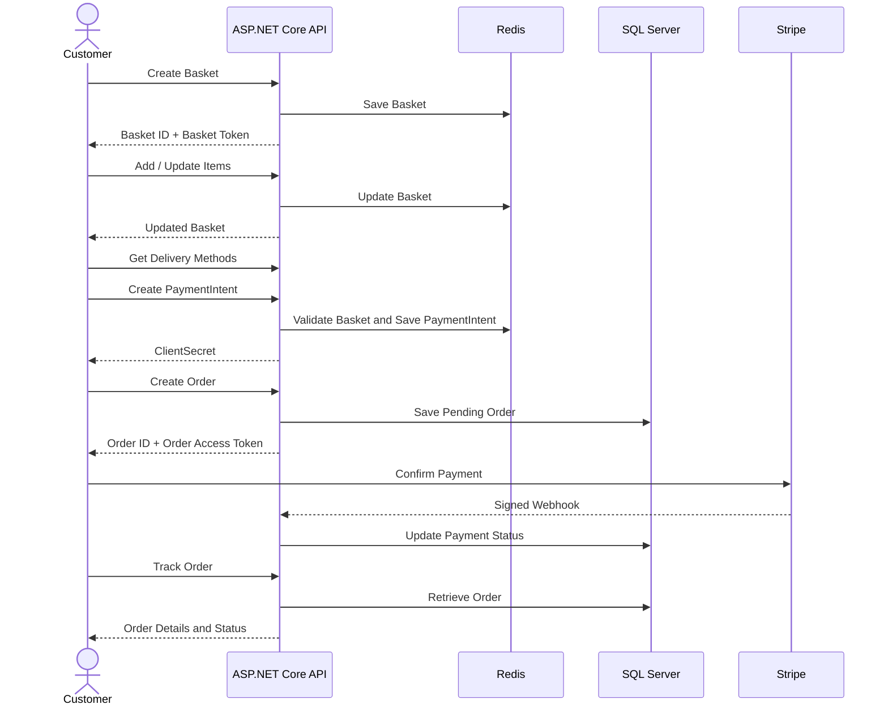

# 🛍️ E-Commerce Backend API

<div align="center">

**A complete .NET 9 REST API for product catalog, guest checkout, order management, identity, and Stripe payments.**

<p>
  
  
  
  
  
</p>

</div>

---

## 📑 Contents

- [Overview](#overview)
- [Features](#features)
- [Technology Stack](#technology-stack)
- [Architecture and Design Patterns](#architecture-and-design-patterns)
- [Project Structure](#project-structure)
- [Database and Seeding](#database-and-seeding)
- [API Reference](#api-reference)
- [Authentication and Security](#authentication-and-security)
- [Guest Checkout and Order Tracking](#guest-checkout-and-order-tracking)
- [Payment Workflow](#payment-workflow)
- [Getting Started](#getting-started)
- [Local Stripe Testing](#local-stripe-testing)
- [Configuration](#configuration)
- [Resources](#resources)

---

## Overview

A layered E-Commerce backend built with **.NET 9** and **ASP.NET Core Web API**.

The API provides product catalog management, Redis-backed shopping baskets, guest checkout, order tracking, identity management, email notifications, and Stripe payment integration.

It uses SQL Server and Entity Framework Core for persistent data, Redis for basket storage and caching, ASP.NET Core Identity for account management, and JWT for authentication.

---

## Features

### 🛍️ Product Catalog
- Product browsing, searching, filtering, sorting, and pagination.
- Product brands and types.
- Product details and management.
- Redis caching for catalog responses.

### 🔐 Identity and Security
- JWT authentication and role management.
- Admin and SuperAdmin registration workflows.
- Email confirmation and password management.
- User address retrieval and updates.
- Secure basket and guest-order access tokens.

### 🛒 Basket and Checkout
- Redis-backed shopping baskets.
- Add, update, and remove basket items.
- Quantity validation and price refreshing.
- Delivery methods and cost calculation.
- Guest checkout without account registration.

### 📦 Orders and Tracking
- Order creation and management.
- PaymentIntent-linked orders.
- Order tracking using secure access tokens.
- Pending, PaymentReceived, and PaymentFailed statuses.

### 💳 Payments and Notifications
- Stripe PaymentIntents integration.
- Stripe Elements payment confirmation.
- Signed webhook verification.
- Successful and failed payment processing.
- Order confirmation email notifications.

---

## Technology Stack

| Category | Technology |
|---|---|
| Backend | .NET 9, ASP.NET Core Web API, C# |
| ORM | Entity Framework Core 9 |
| Databases | Microsoft SQL Server, Redis |
| Identity | ASP.NET Core Identity |
| Authentication | JWT Bearer |
| Mapping | AutoMapper |
| Payments | Stripe.net, Stripe PaymentIntents |
| Email | MailKit SMTP |
| API Documentation | OpenAPI / Swagger |
| Development Tools | Visual Studio, .NET CLI, Stripe CLI |

---

## Architecture and Design Patterns

The solution follows **Onion / Layered Architecture**, separating business logic from infrastructure and external services.


### Design Patterns and Principles

| Pattern / Principle | Usage |
|---|---|
| Onion Architecture | Separates core business logic from external dependencies. |
| Repository Pattern | Abstracts data access behind interfaces. |
| Generic Repository | Provides reusable data access operations. |
| Unit of Work | Coordinates repositories and persistence operations. |
| Specification Pattern | Encapsulates filtering, sorting, pagination, and query criteria. |
| Result Pattern | Represents operation success and failure explicitly. |
| DTO Pattern | Separates API models from domain entities. |
| Dependency Injection | Manages service dependencies through the built-in DI container. |
| AutoMapper | Maps entities and DTOs. |
| Options Pattern | Provides strongly typed configuration. |
| SOLID Principles | Supports maintainable and extensible application design. |

### Additional Implementation Concepts

- EF Core Fluent API and Entity Configurations.
- Async/Await and LINQ.
- Middleware and Action Filters.
- JWT Claims and Role-Based Authorization.
- Redis Caching and Basket Persistence.
- Separation of Concerns and Dependency Inversion.

---

## Project Structure

```text
E-commerce/
│
├── E-commerce.API/
│   ├── Attributes/
│   ├── Controllers/
│   ├── DataSeed/
│   ├── Extensions/
│   ├── Properties/
│   └── Program.cs
│
├── E-commerce.Application/
│   ├── Contracts/
│   ├── DTOs/
│   ├── IServices/
│   ├── Profiles/
│   ├── Services/
│   └── Specifications/
│
├── E-commerce.Domain/
│   ├── Contracts/
│   └── Entities/
│
├── E-commerce.Infrastructure/
│   ├── Configurations/
│   ├── Data/
│   ├── Identity/
│   ├── Migrations/
│   ├── Repositories/
│   ├── Seeding/
│   └── Services/
│
├── docs/
│   └── payment-test.html
│
├── postman/
├── E-commerce.sln
└── README.md
```

---

## Database and Seeding

### Database Design

| Entity | Purpose |
|---|---|
| Product | Product details, price, brand, and type |
| ProductBrand / ProductType | Product classifications |
| CustomerBasket / BasketItem | Redis-backed shopping basket |
| DeliveryMethod | Delivery options and costs |
| Order / OrderItem | Order and purchased products |
| ProductItemOrdered | Product snapshot within an order |
| ApplicationUser / Address | Identity account and shipping address |

### Persistence

- SQL Server for catalog, identity, and order data.
- Redis for shopping baskets and catalog caching.
- Separate EF Core DbContexts for catalog/order and identity data.
- EF Core migrations for database schema management.

### Data Seeding

- Initial product brands, types, and catalog data.
- Identity roles and initial identity data.
- Startup seeding for development setup.

---

## API Reference

**Base URL:** `https://localhost:7070`

### Products

| Method | Endpoint | Access |
|---|---|---|
| GET | `/api/Product` | Public |
| GET | `/api/Product/Search` | Public |
| GET | `/api/Product/{id}` | Public |
| GET | `/api/Product/Brands` | Public |
| GET | `/api/Product/Types` | Public |
| PUT | `/api/Product/{id}` | Public |

### Authentication

| Method | Endpoint | Access |
|---|---|---|
| POST | `/api/Authentication/login` | Public |
| POST | `/api/Authentication/register-admin` | Public |
| POST | `/api/Authentication/register-superadmin` | Public |
| GET | `/api/Authentication/emailexists?email={email}` | Public |
| GET | `/api/Authentication/currentuser` | Bearer JWT |
| GET | `/api/Authentication/address` | Bearer JWT |
| PUT | `/api/Authentication/address` | Bearer JWT |
| GET | `/api/Authentication/confirmemail` | Public |
| POST | `/api/Authentication/forgot-password` | Public |
| POST | `/api/Authentication/reset-password` | Public |
| POST | `/api/Authentication/change-password` | Bearer JWT |

### Baskets

Basket creation is public. Other basket operations require `X-Basket-Token`.

| Method | Endpoint | Access |
|---|---|---|
| POST | `/api/Baskets` | Public |
| GET | `/api/Baskets/{id}` | Basket Token |
| POST | `/api/Baskets/{id}/items` | Basket Token |
| PUT | `/api/Baskets/{id}/items/{productId}` | Basket Token |
| DELETE | `/api/Baskets/{id}/items/{productId}` | Basket Token |
| DELETE | `/api/Baskets/{id}` | Basket Token |

### Orders

| Method | Endpoint | Access |
|---|---|---|
| GET | `/api/Order/deliveryMethods` | Public |
| POST | `/api/Order` | Basket Token |
| GET | `/api/Order/{orderId}/track` | Order Access Token |

### Payments

| Method | Endpoint | Access |
|---|---|---|
| POST | `/api/Payment/{basketId}?deliveryMethodId={id}` | Basket Token |
| POST | `/api/Payment/webhook` | Stripe Signature |

---

## Authentication and Security

### Account Authentication

- ASP.NET Core Identity manages user accounts and roles.
- JWT Bearer authentication protects account-related endpoints.
- JWT validation checks issuer, audience, lifetime, and signing key.
- Identity roles include `Admin` and `SuperAdmin`.

### Guest Access

Guest checkout does not require JWT authentication.

The application uses separate access tokens:

| Header | Purpose |
|---|---|
| `X-Basket-Token` | Authorizes basket operations. |
| `X-Order-Access-Token` | Authorizes guest order tracking. |

Access tokens are generated by the application, while their SHA-256 hashes are stored for validation.

---

## Guest Checkout and Order Tracking

Customers can complete purchases without creating an account.

Each guest basket is protected by a basket token. When an order is created, a separate order access token is generated for future tracking.

### Checkout Sequence



### Important Notes

- PaymentIntent is created before the order.
- The order is created with `Pending` payment status.
- The order stores its associated PaymentIntent ID.
- Stripe webhooks update the order's payment status.
- The order access token is required for guest tracking.

---

## Payment Workflow

The application integrates Stripe PaymentIntents for secure payment processing.

### End-to-End Flow

**1. Create a Basket**

```http
POST /api/Baskets
```

Save the returned basket ID and basket token.

**2. Add Products**

```http
POST /api/Baskets/{basketId}/items
X-Basket-Token: {basket-token}
```

**3. Retrieve Delivery Methods**

```http
GET /api/Order/deliveryMethods
```

Choose the required delivery method.

**4. Create or Update PaymentIntent**

```http
POST /api/Payment/{basketId}?deliveryMethodId={id}
X-Basket-Token: {basket-token}
```

The backend validates the basket, refreshes product prices, calculates the total, and creates or updates the Stripe PaymentIntent.

The response includes the `clientSecret` required for payment confirmation.

**5. Create the Order**

```http
POST /api/Order
X-Basket-Token: {basket-token}
```

Provide the required customer, delivery, and shipping information.

The backend validates the basket and PaymentIntent, creates the order with `Pending` payment status, and returns the order ID and order access token.

**6. Confirm Payment**

Use Stripe Elements and the PaymentIntent `clientSecret` to complete the card payment.

**7. Process Webhooks**

Stripe sends a signed webhook to:

```http
POST /api/Payment/webhook
```

Supported events:

| Stripe Event | Order Status |
|---|---|
| `payment_intent.succeeded` | `PaymentReceived` |
| `payment_intent.payment_failed` | `PaymentFailed` |

After successful payment, the application sends an order confirmation email.

**8. Track the Order**

```http
GET /api/Order/{orderId}/track
X-Order-Access-Token: {order-access-token}
```

The API validates the access token and returns the order's latest tracking information and payment status.

---

## Getting Started

### Prerequisites

- .NET 9 SDK
- Microsoft SQL Server or SQL Server Express
- Redis
- Stripe test account
- Stripe CLI
- SMTP account for email functionality

### 1. Clone and Restore

```bash
git clone <repository-url>
cd <repository-folder>
dotnet restore E-commerce.sln
```

### 2. Configure Secrets

Initialize User Secrets:

```bash
dotnet user-secrets init --project E-commerce.API
```

Configure the required credentials:

```bash
dotnet user-secrets set "Jwt:SecretKey" "<long-random-secret>" --project E-commerce.API

dotnet user-secrets set "Stripe:SecretKey" "<sk_test_...>" --project E-commerce.API

dotnet user-secrets set "Stripe:WebhookSecret" "<whsec_...>" --project E-commerce.API

dotnet user-secrets set "EmailSettings:Password" "<smtp-password>" --project E-commerce.API
```

Configure the SQL Server and Redis connection strings using the application's expected configuration keys.

### 3. Apply Database Migrations

```bash
dotnet ef database update --project E-commerce.Infrastructure --startup-project E-commerce.API --context StoreDBContext

dotnet ef database update --project E-commerce.Infrastructure --startup-project E-commerce.API --context StoreIdentityDbContext
```

### 4. Run the API

```bash
dotnet run --project E-commerce.API --launch-profile https
```

| URL | Purpose |
|---|---|
| `https://localhost:7070` | HTTPS API |
| `http://localhost:5261` | HTTP API |
| `https://localhost:7070/swagger` | Swagger UI |

---

## Local Stripe Testing

The repository includes a standalone Stripe Elements test page:

`docs/payment-test.html`

### 1. Configure Stripe Test Mode

Open [Stripe Dashboard - Test Mode](https://dashboard.stripe.com/test).

Copy your test publishable key:

```text
pk_test_...
```

Configure the backend:

```text
Stripe:SecretKey       = <sk_test_...>
Stripe:WebhookSecret   = <whsec_...>
Stripe:DefaultCurrency = USD
```

Never expose the Stripe secret key in HTML or JavaScript.

### 2. Start the API

Make sure the API is running at:

```text
https://localhost:7070
```

### 3. Create a Basket and Add Products

Use Swagger or your API client to create a basket and add products.

Save the basket ID and `X-Basket-Token`.

### 4. Create a PaymentIntent

```http
POST /api/Payment/{basketId}?deliveryMethodId=1
X-Basket-Token: {basket-token}
```

Copy the returned `clientSecret`.

### 5. Create the Order

Before confirming payment, create the order:

```http
POST /api/Order
X-Basket-Token: {basket-token}
```

Provide the required checkout information and save:

- Order ID
- Order Access Token

The order should initially have `Pending` payment status.

### 6. Start Stripe CLI

Authenticate:

```bash
stripe login
```

Forward payment events to the API:

```bash
stripe listen --events payment_intent.succeeded,payment_intent.payment_failed --forward-to https://localhost:7070/api/Payment/webhook
```

Copy the generated `whsec_...` value into `Stripe:WebhookSecret` and restart the API.

### 7. Open the Payment Test Page

Open:

```text
docs/payment-test.html
```

Replace the placeholders with the Stripe test publishable key and the returned `clientSecret`.

Use Stripe's test card:

| Field | Value |
|---|---|
| Card Number | `4242 4242 4242 4242` |
| Expiry Date | Any future date |
| CVC | Any 3 digits |
| ZIP | Any valid test ZIP |

Complete the payment using Stripe Elements.

### 8. Verify Payment Status

For successful payments, the backend should process:

```text
payment_intent.succeeded
```

The order status becomes:

```text
PaymentReceived
```

For failed payments:

```text
payment_intent.payment_failed
```

The order status becomes:

```text
PaymentFailed
```

### 9. Track the Order

Use the saved order ID and access token:

```http
GET /api/Order/{orderId}/track
X-Order-Access-Token: {order-access-token}
```

The API returns the order details and latest payment status.

### Troubleshooting

- Ensure SQL Server and Redis are running.
- Keep the API and Stripe CLI listener running.
- Use matching Stripe test keys.
- Use the latest webhook signing secret.
- Trust the local HTTPS development certificate.
- Verify that the order exists and has the correct PaymentIntent ID.
- Check API logs and Stripe CLI output for webhook errors.

The standalone test page uses Stripe Elements directly and does not require backend CORS configuration.

---

## Configuration

Expected configuration keys include:

```text
ConnectionStrings:DefaultConnection
ConnectionStrings:IdentityConnection
ConnectionStrings:Redis

Jwt:SecretKey
Jwt:Issuer
Jwt:Audience
Jwt:ExpirationMinutes

UrlSettings:BaseUrl
EmailConfirmation:BaseUrl
EmailSettings:*

Stripe:SecretKey
Stripe:DefaultCurrency
Stripe:WebhookSecret
```

### Security Notes

- Never commit credentials, API keys, or connection strings.
- Keep JWT signing keys and webhook secrets private.
- Use User Secrets for local development.
- Use environment variables or a managed secret provider in production.

Nested environment variables use double underscores:

```text
Stripe__SecretKey
Stripe__WebhookSecret
```

---

## Resources

- [ASP.NET Core Documentation](https://learn.microsoft.com/aspnet/core/)
- [Entity Framework Core](https://learn.microsoft.com/ef/core/)
- [ASP.NET Core Identity](https://learn.microsoft.com/aspnet/core/security/authentication/identity)
- [Stripe API Documentation](https://docs.stripe.com/api)
- [Stripe PaymentIntents](https://docs.stripe.com/payments/payment-intents)
- [Stripe Testing](https://docs.stripe.com/testing)
- [Stripe CLI](https://docs.stripe.com/stripe-cli)

---


