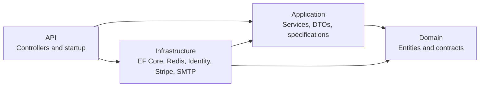

# E-Commerce Backend API

A .NET 9 backend for an e-commerce system with product management, JWT authentication, Redis-backed baskets, order tracking, email workflows, and Stripe payments.

## Table of Contents

- [Overview](#overview)
- [Features](#features)
- [Tech Stack](#tech-stack)
- [Architecture](#architecture)
- [Project Structure](#project-structure)
- [Database](#database)
- [API Endpoints](#api-endpoints)
- [Authentication](#authentication)
- [Stripe Payments](#stripe-payments)
- [Getting Started](#getting-started)
- [Payment Testing](#payment-testing)
- [Configuration](#configuration)
- [Resources](#resources)

## Overview

The solution is divided into API, Application, Domain, and Infrastructure projects. SQL Server stores catalog, order, delivery, and identity data; Redis stores baskets and cached product responses.

## Features

- Product filtering, searching, pagination, brands, types, and updates
- Redis product caching
- JWT login and ASP.NET Core Identity
- Email confirmation, password reset/change, and SMTP tests
- Admin and SuperAdmin role data
- Redis shopping baskets with secure hashed access tokens
- Basket item quantity validation and server-side price refresh
- Order creation, delivery methods, and secure guest tracking
- Stripe PaymentIntents and webhook status updates
- Automatic migrations and startup data seeding

## Tech Stack

- **Backend:** .NET 9, ASP.NET Core, C#, AutoMapper
- **Database:** SQL Server, Entity Framework Core 9
- **Cache:** Redis, StackExchange.Redis
- **Security:** ASP.NET Core Identity, JWT Bearer
- **Payments:** Stripe.net / Stripe PaymentIntents
- **Email:** MailKit
- **Documentation:** ASP.NET Core OpenAPI, Swagger UI

## Architecture



- **E-commerce.API:** HTTP endpoints and application startup.
- **E-commerce.Application:** Business logic, mappings, DTOs, specifications, and interfaces.
- **E-commerce.Domain:** Entities and repository/unit-of-work contracts.
- **E-commerce.Infrastructure:** SQL Server, Identity, Redis, migrations, email, and Stripe implementations.

## Project Structure

```text
E-commerce/
├── E-commerce.API/
├── E-commerce.Application/
├── E-commerce.Domain/
├── E-commerce.Infrastructure/
├── docs/
│   └── payment-test.html
├── postman/
└── E-commerce.sln
```

`docs/payment-test.html` is a standalone Stripe Elements page for testing a hard-coded test PaymentIntent client secret.

## Database

Main entities:

- `Product`, `ProductBrand`, `ProductType`
- `CustomerBasket`, `BasketItem`
- `Order`, `OrderItem`, `OrderAddress`, `DeliveryMethod`
- `ApplicationUser`, `Address`

Products belong to a brand and type. Orders contain items and one delivery method; shipping addresses and ordered-product snapshots are stored as owned entities. Basket data is Redis-backed. Identity data uses its own DbContext and SQL Server database.

The API applies pending migrations and seeds catalog data, roles, and an initial admin account at startup.

## API Endpoints

Base URL: `https://localhost:7070`

### Products

| Method | Endpoint | Authentication |
|---|---|---|
| `GET` | `/api/Product` | Public |
| `GET` | `/api/Product/Search` | Public |
| `GET` | `/api/Product/{id}` | Public |
| `GET` | `/api/Product/Brands` | Public |
| `GET` | `/api/Product/Types` | Public |
| `PUT` | `/api/Product/{id}` | Public |

### Authentication

| Method | Endpoint | Authentication |
|---|---|---|
| `POST` | `/api/Authentication/login` | Public |
| `POST` | `/api/Authentication/register-admin` | Public |
| `POST` | `/api/Authentication/register-superadmin` | Public |
| `GET` | `/api/Authentication/emailexists?email={email}` | Public |
| `GET` | `/api/Authentication/currentuser` | Bearer JWT |
| `GET` | `/api/Authentication/address` | Bearer JWT |
| `PUT` | `/api/Authentication/address` | Bearer JWT |
| `GET` | `/api/Authentication/confirmemail?userId={id}&token={token}` | Public |
| `POST` | `/api/Authentication/forgot-password` | Public |
| `POST` | `/api/Authentication/reset-password` | Public |
| `POST` | `/api/Authentication/change-password` | Bearer JWT |

### Baskets

Basket operations require `X-Basket-Token`, except basket creation.

| Method | Endpoint | Authentication |
|---|---|---|
| `POST` | `/api/Baskets` | Public |
| `GET` | `/api/Baskets/{id}` | Basket token |
| `POST` | `/api/Baskets/{id}/items` | Basket token |
| `PUT` | `/api/Baskets/{id}/items/{productId}` | Basket token |
| `DELETE` | `/api/Baskets/{id}/items/{productId}` | Basket token |
| `DELETE` | `/api/Baskets/{id}` | Basket token |

### Orders and Payments

| Method | Endpoint | Authentication |
|---|---|---|
| `POST` | `/api/Order` | Public |
| `GET` | `/api/Order/deliveryMethods` | Public |
| `GET` | `/api/Order/{orderId}/track` | `X-Order-Access-Token` |
| `POST` | `/api/Payment/{basketId}?deliveryMethodId={id}` | Basket token |
| `POST` | `/api/Payment/webhook` | Stripe signature |
| `POST` | `/api/EmailTest/send?to={email}` | Development only |

## Authentication

- Login requires a confirmed email and valid password.
- Login and current-user endpoints return JWTs.
- JWT validation checks issuer, audience, lifetime, and signing key.
- Protected endpoints use `[Authorize]`.
- Identity roles are `Admin` and `SuperAdmin`.
- Basket and order tracking use separate SHA-256 hashed access tokens.

## Stripe Payments

1. Create and populate a basket.
2. Call `POST /api/Payment/{basketId}?deliveryMethodId={id}` with `X-Basket-Token`.
3. The API refreshes product prices, calculates subtotal and delivery, and creates or updates a Stripe PaymentIntent.
4. Use the returned `ClientSecret` to confirm payment in Stripe Elements.
5. Create the order through `POST /api/Order`.
6. Stripe sends a signed webhook to `/api/Payment/webhook`.

Supported webhook events:

- `payment_intent.succeeded` changes the order to `PaymentReceived` and sends a one-time confirmation email.
- `payment_intent.payment_failed` changes the order to `PaymentFailed`.

## Getting Started

### Prerequisites

- .NET 9 SDK
- SQL Server or SQL Server Express
- Redis
- Stripe test account
- Stripe CLI
- SMTP account for email features

### Setup

```bash
git clone <repository-url>
cd <repository-folder>
dotnet restore E-commerce.sln
```

Configure local secrets:

```bash
dotnet user-secrets init --project E-commerce.API
dotnet user-secrets set "Jwt:SecretKey" "<long-random-secret>" --project E-commerce.API
dotnet user-secrets set "Stripe:SecretKey" "<sk_test_...>" --project E-commerce.API
dotnet user-secrets set "Stripe:WebhookSecret" "<whsec_...>" --project E-commerce.API
dotnet user-secrets set "EmailSettings:Password" "<smtp-password>" --project E-commerce.API
```

Required configuration includes:

- `ConnectionStrings:DefaultConnection`
- `ConnectionStrings:IdentityConnection`
- `ConnectionStrings:Redis`
- `Jwt:*`
- `Stripe:*`
- `EmailSettings:*`
- `EmailConfirmation:BaseUrl`

Run the API:

```bash
dotnet run --project E-commerce.API --launch-profile https
```

- API: `https://localhost:7070`
- HTTP: `http://localhost:5261`
- Swagger: `https://localhost:7070/swagger`

Startup automatically applies pending migrations for both DbContexts and seeds data.

## Payment Testing

1. In the [Stripe Dashboard](https://dashboard.stripe.com/) test mode, copy a publishable key beginning with `pk_test_`.
2. Replace the `Stripe("...")` value in `docs/payment-test.html`. Put the `sk_test_...` secret only in backend configuration.
3. Run the API and keep it running.
4. Install the [Stripe CLI](https://docs.stripe.com/stripe-cli), then authenticate:

```bash
stripe login
```

5. Start the webhook listener:

```bash
stripe listen --events payment_intent.succeeded,payment_intent.payment_failed --forward-to https://localhost:7070/api/Payment/webhook
```

6. Copy the CLI-generated `whsec_...` value into `Stripe:WebhookSecret`, then restart the API.
7. Create a basket, add a product, and call `/api/Payment/{basketId}?deliveryMethodId={id}` with `X-Basket-Token`.
8. Copy the returned `client_secret` into `docs/payment-test.html` and open the HTML file in a browser.
9. Create the order through `/api/Order` before confirming payment.
10. Pay with the Stripe test card:

```text
Card: 4242 4242 4242 4242
Expiry: Any future date
CVC: Any 3 digits
ZIP: Any valid test ZIP
```

Confirm the CLI receives the event and that the order changes to `PaymentReceived` or `PaymentFailed`.

Common issues:

- API, Redis, SQL Server, or Stripe listener not running
- Mismatched Stripe secret and publishable keys
- Invalid or stale `whsec_...` webhook secret
- HTTPS certificate not trusted
- No order created for the PaymentIntent
- SMTP credentials missing or incorrect

The API does not currently configure CORS.

## Configuration

Never commit secrets or real connection strings. Recommended local options:

- ASP.NET Core user secrets
- Environment variables
- A managed secret provider in deployment

Nested environment variables use double underscores, for example `Stripe__SecretKey`.

## Resources

- [ASP.NET Core](https://learn.microsoft.com/aspnet/core/)
- [Entity Framework Core](https://learn.microsoft.com/ef/core/)
- [Stripe API](https://docs.stripe.com/api)
- [Stripe Testing](https://docs.stripe.com/testing)
- [Stripe CLI](https://docs.stripe.com/stripe-cli)
